# A Handful of Men: Player's Manual

*A tactical stealth game for the Amstrad CPC 6128*

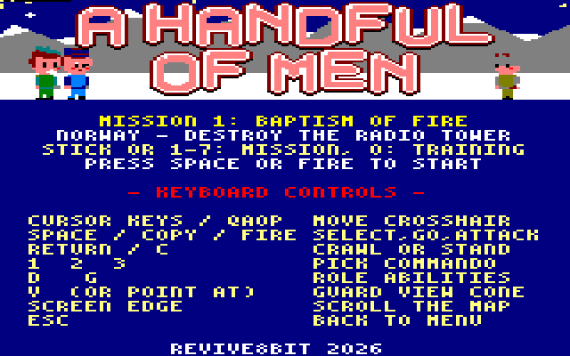

## Contents

1. Introduction
2. Getting started
3. Controls
4. The title menu and briefings
5. The screen
6. Your commandos
7. Staying unseen
8. Winning and losing
9. Training: Boot Camp
10. The missions
11. Tips

## 1. Introduction

Norway, winter. A handful of men, each with one special skill, is all it
takes to cripple the enemy, one target at a time. You never control an
army: you lead two or three commandos through guarded camps, out of sight
of sentries, to blow up a radio tower, a fuel depot or a train, and then
get every survivor out in the waiting truck.

*A Handful of Men* is an 8-bit homage to *Commandos: Behind Enemy Lines*,
drawn in a cute, chibi style and written for the Amstrad CPC.

## 2. Getting started

**You need** an Amstrad CPC 6128, or a CPC 464 or 664 with a 64K memory
expansion (128K in total). It also runs in any CPC emulator set to a
CPC 6128. On a 64K machine the loader says that 128K is needed and
returns to BASIC.

**To load:** insert the disc `handful_of_men.dsk` and type:

```
RUN"DISC
```

The title menu appears after a few seconds of loading.

## 3. Controls

The keyboard and a joystick can be used together.

| Key | Action |
| --- | --- |
| Cursor keys, QAOP or joystick | move the crosshair; push against the edge of the screen to scroll the map |
| Space, Copy or Fire | select the commando under the crosshair, send the selected commando there, or attack what is under it |
| Return, Fire 2 or C | crawl / stand up |
| 1, 2, 3 | select a commando (the portraits in the panel, left to right) |
| D | the selected commando's first special ability |
| G | his second special ability |
| V | pin the vision cone of the sentry under the crosshair |
| Esc | give up and go back to the title menu |

Moving the crosshair over a sentry also shows his vision cone.

## 4. The title menu and briefings

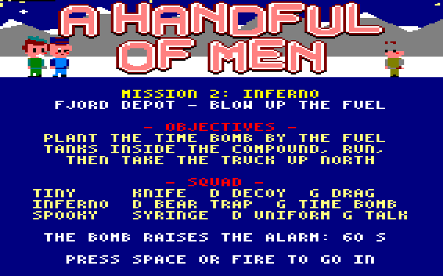

The title menu shows the selected mission and a summary of the controls.

- **Choose a mission** with the joystick or the cursor keys (they step
  through all the missions and the training course), or press **1** to
  **7** for a mission and **0** for the training course.
- Press **Space** or **Fire** to open the **briefing**: the objective,
  and what each commando's D and G keys do.
- Press **Space** or **Fire** again to start.

When you accomplish a mission, the menu moves on to the next one.

## 5. The screen

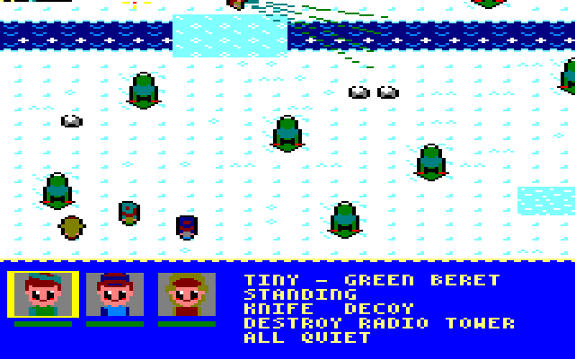

The top part of the screen is the map. The panel at the bottom shows:

- **The portraits** of your commandos. The selected one is framed in
  yellow; the bar under each portrait is his health.
- **His name and role**, and whether he is standing, crawling, swimming
  or in disguise.
- **His kit**: weapons and abilities, with the Sniper's rounds and the
  Sapper's traps and bombs left.
- **The objective**: what to do next.
- **The alarm**: "ALL QUIET", or the seconds left before enemy
  reinforcements arrive.

## 6. Your commandos

Each mission gives you two or three of these five men.

| Commando | Attack | D | G |
| --- | --- | --- | --- |
| **Tiny**, Green Beret | knife: silent, close range | drop a radio decoy; press again to make it ping | grab or drop a barrel or a body within reach |
| **Fins**, Marine | harpoon: silent, short range | — | — |
| **Duke**, Sniper | rifle: long range, needs a clear line of sight, 5 rounds, loud | — | — |
| **Inferno**, Sapper | does not fight | lay a bear trap at his feet (2) | plant the time bomb (1) |
| **Spooky**, Spy | syringe: silent, close range | put on or take off a German uniform | in uniform, talk to the sentry next to him |

- **The Marine swims.** He crosses rivers, canals and the sea, and can't
  be seen in the water.
- **The bear trap** kills a sentry who walks onto it, silently.
- **The time bomb** goes off 10 seconds after it is planted, with a blast
  about three tiles across. It always raises the alarm, so plant it and
  run.
- **In uniform** the Spy is taken for one of the enemy. A sentry he talks
  to turns to face him and stays put as long as he stays close, which
  leaves the sentry's back open to your other men.
- **Barrels** explode only when shot, and the blast sets off nearby
  barrels and destroys whatever is close enough.

To give an order, select a commando (click on him, or press 1, 2 or 3),
then click where he should go or what he should attack. Commandos walk
around trees, rocks, buildings, fences and water by themselves. A place
nobody can reach is ignored.

## 7. Staying unseen

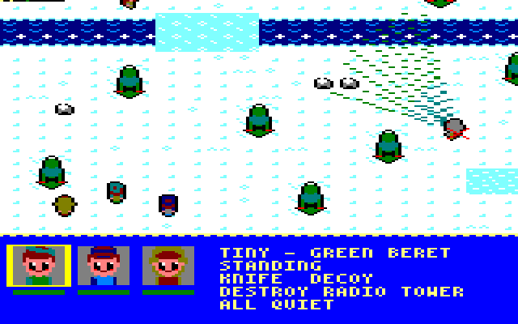

- **Sentries see in a cone** in front of them. Up close they see
  anything, even crawling men and bodies. Further away they only notice
  men standing up. Trees, rocks and buildings block their view.
- **Crawl** to slip past at a distance, but it is slow.
- **Footsteps on snow** can be heard nearby. A sentry who hears them
  comes to look, with a **?** over his head, for about 10 seconds, then
  goes back to his patrol. The Green Beret's decoy draws sentries from
  further away and holds them for about 25 seconds.
- **When a sentry spots you**, a **!** appears over his head. You have
  about a second and a half to get away or deal with him. After that he
  opens fire, the siren sounds and every sentry joins in.

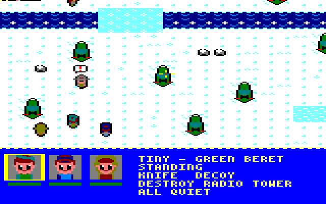

- **The alarm** gives you 60 seconds to finish the job and get away before
  enemy reinforcements arrive. Explosions always raise it.

## 8. Winning and losing

**To win**, destroy the mission's target, then get every surviving
commando into the truck. Men can climb in early and wait.

**You lose** if the whole squad is lost, or if the alarm runs out and
enemy reinforcements arrive.

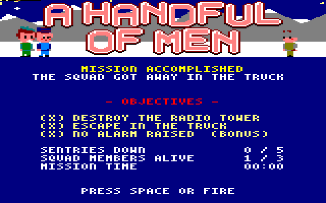

The debrief shows whether the target was destroyed and the squad got
away, and the **bonus objective**: finishing without ever raising the
alarm. It also counts the sentries taken down, the men still alive and
the time taken.

## 9. Training: Boot Camp

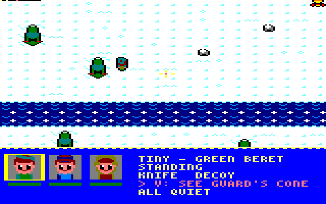

New to the game? Press **0** on the title menu. Boot Camp is a gentle
course from the south-west corner to the truck, with the Green Beret, the
Marine and the Sniper. As your selected commando reaches each lesson, a
pink tip replaces the objective in the panel: walking, picking a man,
swimming, crawling up behind a sentry and knifing him, watching a
patrol's vision cone, the decoy, and the Sniper's shot at the barrel by
the training mast. Finish it and the menu moves on to Mission 1.

## 10. The missions

### Mission 1: Baptism of Fire

*Squad: Green Beret, Marine, Sniper.*

Bring down the radio tower inside the compound. A shot at the barrel
right next to its base will do. Then get the squad into the truck at the
road junction.

### Mission 2: Inferno

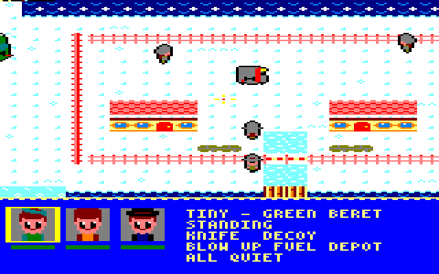

*Squad: Green Beret, Sapper, Spy.*

A fuel depot on a fjord, inside a fenced compound with a single gate on
the south road. Plant the time bomb by the fuel tanks, run, then take the
truck at the north-west end of the road.

### Mission 3: Rough Waters

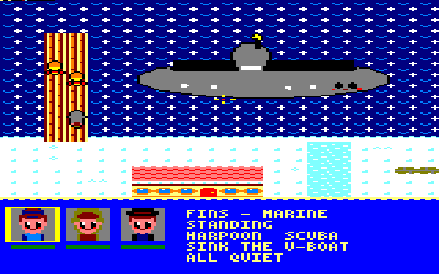

*Squad: Marine, Sniper, Spy.*

A U-boat is moored at a wooden pier, with fuel barrels stacked beside it.
The dock yard is fenced, with one gate on the east road, but a canal
runs down the west edge: the Marine's way in. Shoot the barrels to sink
her, then get to the truck south of the gate.

### Mission 4: A Bridge Too Far

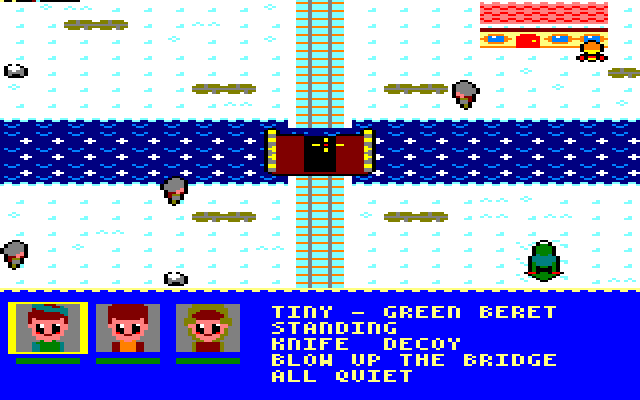

*Squad: Green Beret, Sapper, Sniper.*

A railway crosses a river on a steel bridge, with sandbagged posts at
both ends. Blow the bridge with the time bomb, then reach the truck in
the camp on the north bank. Once the bridge is down, the frozen ford in
the west is the only way across.

### Mission 5: The Guns of Vardo

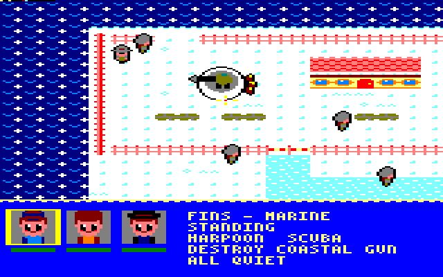

*Squad: Marine, Sapper, Spy.*

A coastal gun in a concrete pit, inside a fenced battery on a headland.
The only gate faces the south road, but there is a gap in the north
fence that only the Marine can reach, by swimming up the coast. Blow the
gun with the time bomb, then take the truck east along the road.

### Mission 6: Heavy Water

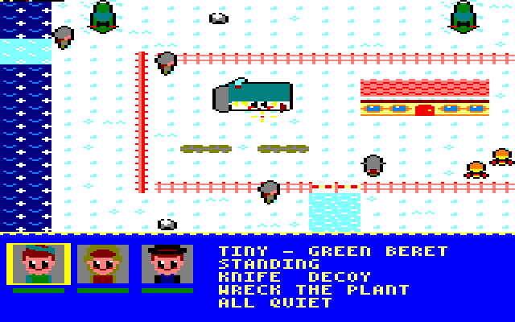

*Squad: Green Beret, Sniper, Spy.*

The heavy water plant stands in a fenced compound across a river gorge,
reached over a guarded wooden bridge or a frozen stretch further north.
The fuel barrels are in a far corner, too far for their blast to reach
the plant: the Green Beret must drag one over before the Sniper shoots
it. Then get back across the gorge to the truck.

### Mission 7: Night Train

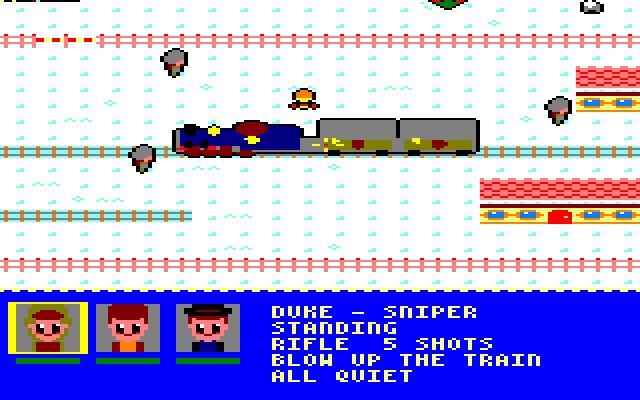

*Squad: Sniper, Sapper, Spy.*

An ammunition train stands in a station yard, fenced to the north and
south with a gate in each fence. Blow it up with the time bomb, or give
the Sniper a clear shot at the barrel beside the middle wagon. Then
leave through the south gate for the truck.

## 11. Tips

- **Look before you move.** Point at each sentry to see his cone, and
  learn his patrol before you cross it.
- **Crawl near sentries** and walk only where no one can hear you.
- **Strike from behind.** The knife, harpoon and syringe are silent; the
  rifle is not.
- **Hide your work.** The Green Beret can drag a body out of sight before
  another patrol finds it.
- **Use the decoy and the Spy** to turn a sentry away from the path you
  need.
- **Plan the getaway.** An explosion starts the 60-second alarm, so have
  the squad close to the truck before you blow the target.
